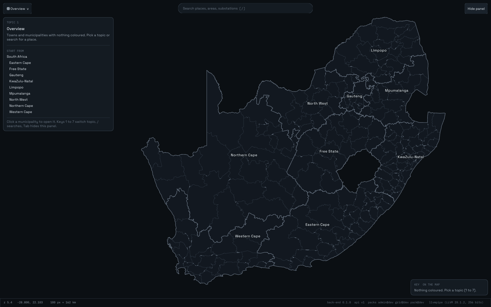
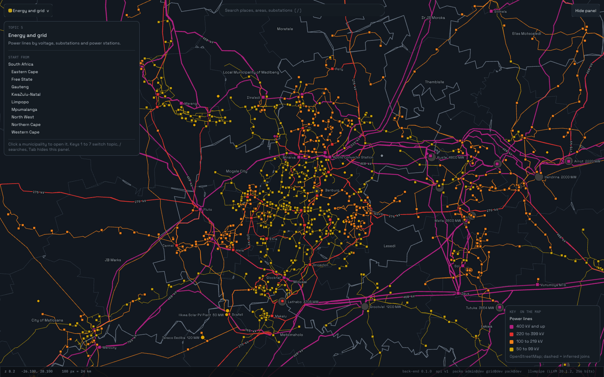
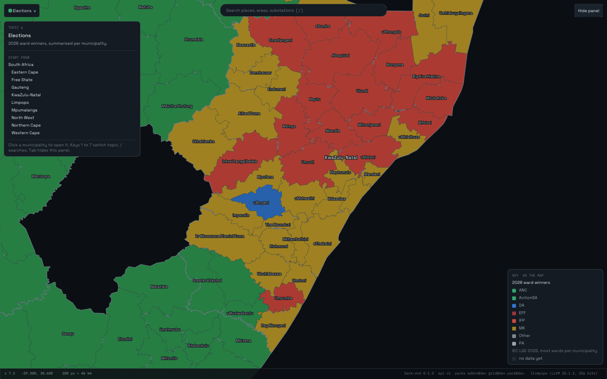
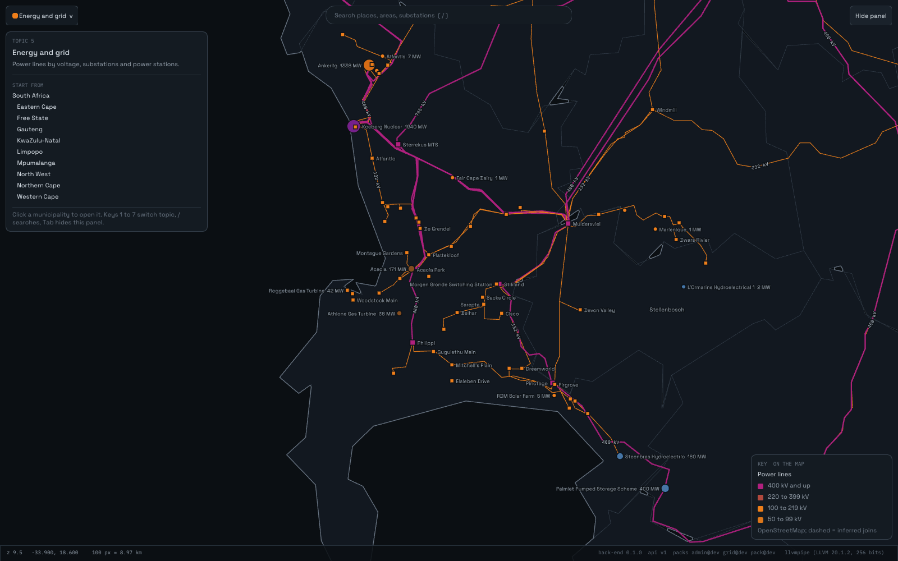
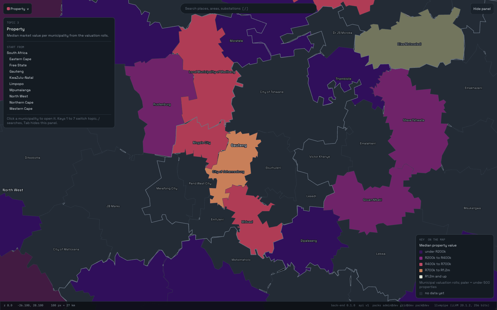

# Grid of SA

A desktop map of South Africa: power grid, water, people, property values, elections and transport,
down to the plot. Native C++ with its own Vulkan renderer, and a back-end service that can move from
your PC to a server without changes.



| | |
|---|---|
|  |  |
|  |  |

## How it fits together

```
+---------------------------+        HTTP /v1 (token)        +-----------------------------+
|  gsa  (front-end)         | -----------------------------> |  gsa-backend                |
|  GLFW window, Vulkan map  |   tiles, search, area tree,    |  PMTiles packs (tiles)      |
|  renderer, Dear ImGui UI  |   packs, versions              |  SQLite pack (numbers,      |
|  starts the back-end on   |                                |  search, tree, graph)       |
|  desktop (random port,    |                                |  same binary on a server    |
|  one-time token)          |                                |  (Linux container)          |
+---------------------------+                                +-----------------------------+
```

- The front-end never reads data files or calls another site. Everything goes through the versioned
  API in [`api/openapi.yaml`](api/openapi.yaml).
- The back-end owns the data: PMTiles packs for every map layer and one SQLite pack for numbers,
  search, the place tree and the grid graph. Both come from the PostGIS data store described in
  `grid-of-sa/datastore/DATA_ARCHITECTURE.md` (project files).
- No owner names, ID numbers or personal contact details exist anywhere in the packs (POPIA).

More: [docs/ARCHITECTURE.md](docs/ARCHITECTURE.md), [docs/ROADMAP.md](docs/ROADMAP.md),
[docs/DATA.md](docs/DATA.md).

## Build

Needs CMake 3.24+, a C++20 compiler, the Vulkan SDK (or `libvulkan-dev` + `glslang-tools`), GLFW,
SQLite (with FTS5), zlib, nlohmann/json and doctest. cpp-httplib, Dear ImGui, protozero, earcut and
stb are fetched by CMake at pinned versions.

Linux (Ubuntu 24.04):

```
sudo apt install ninja-build libsqlite3-dev zlib1g-dev nlohmann-json3-dev doctest-dev \
  libvulkan-dev glslang-tools libglfw3-dev
cmake -S . -B build -G Ninja -DCMAKE_BUILD_TYPE=Release
cmake --build build
ctest --test-dir build
./build/app/gsa            # starts the back-end on devdata/ and opens the map
```

Windows (Visual Studio 2022, Vulkan SDK, vcpkg):

```
cmake -S . -B build -G "Visual Studio 17 2022" -A x64 -DCMAKE_TOOLCHAIN_FILE=%VCPKG_ROOT%/scripts/buildsystems/vcpkg.cmake
cmake --build build --config Release
build\app\Release\gsa.exe
```

Every CI run on Windows also uploads a ready-to-run zip (`GridOfSA-internal-windows-x64`) with the
app, the back-end and the development data pack.

## Run the back-end alone

```
GSA_TOKEN=secret ./build/backend/gsa-backend --data devdata --port 7878
curl -H "Authorization: Bearer secret" "http://127.0.0.1:7878/v1/search?q=beaufort"
GSA_TOKEN=secret ./build/app/gsa --api 127.0.0.1:7878     # point the app at it
```

## Keys

`1`-`7` topics, `/` or `Ctrl K` search, `Tab` panel, `Esc` back, `+` `-` zoom, `0` whole country,
arrows pan, mouse drag pan, wheel zoom, double click zoom in, click a municipality to open it.

## Repository

| Path | What |
|---|---|
| `api/` | OpenAPI contract for `/v1` |
| `backend/` | `gsa-backend`: PMTiles reader, SQLite pack, HTTP API, tests |
| `app/` | `gsa`: Vulkan renderer, MVT decoder, tessellation, tile loader, UI, back-end launcher, tests |
| `common/` | code both share (gzip) |
| `devdata/packs/` | small development pack built from real project data (see `devdata/README.md`) |
| `tools/devpack/` | script that builds the development pack |
| `docs/` | architecture, roadmap, data rules, screenshots |
